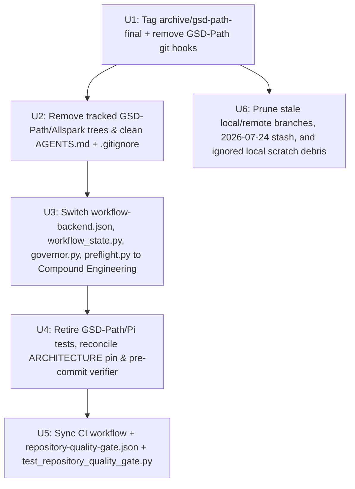

# Retire GSD-Pi and GSD-Path and Clean Repository Debt - Plan

## Goal Capsule

- **Objective:** Leave `law-nexus` with a clean, green CI and working tree governed solely by Compound Engineering and the Unified Rust Standard, with all historical GSD-Pi and GSD-Path delivery records preserved safely in a Git archive tag instead of blocking day-to-day PRs.
- **Means:** Archive the pre-cleanup `main` commit under annotated Git tag `archive/gsd-path-final`, switch `workflow-backend.json` and `workflow_state.py` to Compound Engineering, remove retired GSD-Path/Allspark trees and coupled tests/CI steps, repair pre-existing M012 test pins, and clean stale branches and local scratch paths (KTD1-KTD6).
- **Product authority:** Session-settled Product Contract decisions govern scope and exclusions; follow-on workstreams (CVE upgrades, CI Actions SHA pinning, `calendar.rs` mutation gaps) are outside this plan.
- **Execution profile:** Single pull request (`chore/retire-gsd-and-repo-cleanup` -> `main`) plus local host cleanup (archive tag creation/push, stale branch/stash pruning, untracked local debris removal, local pre-commit hook unchaining).
- **Stop conditions:** Stop if `archive/gsd-path-final` cannot be created and pushed before deletions, if any active Rust/ADR/allowlist/`product-model` check regresses, or if any protected disk path (`consru_export/`, `python_archive/`, `Old_project/`, `archive/`, `product-model/`, `.agents/skills/law-nexus-*`) would be touched.

---

## Product Contract

### Summary

Retire the superseded GSD-Pi, GSD-Path, and Allspark delivery-workflow layers from `main` behind an immutable Git archive tag `archive/gsd-path-final`, switch the repository harness and CI workflow to Compound Engineering, fix the pre-existing M012 CI failures so both `main` and ordinary PRs pass cleanly, and purge stale branches and local workspace debris while preserving active product assets and historical disk vaults.

### Problem Frame

`law-nexus` has migrated to Compound Engineering and the Unified Rust Standard, yet 301 tracked files (~2.8 MB) from retired GSD-Path and Allspark orchestration remain on `main`. That legacy layer causes every non-GSD-Path pull request to fail CI on `Migration layer` because `workflow_state.py` fails closed on detached PR checkouts against `.project/STATE.md`, while four stale M012 doc/roadmap assertions keep `Rust workspace and process harness checks` red on `main`. Leaving retired runtime bundles, 5 stale local branches, 2 stale remote branches, an old 2026-07-24 stash, and local ignored scratch files in place creates ongoing agent confusion and blocks green PR verification.

### Key Decisions

- **Archive via Git tag `archive/gsd-path-final` and remove tracked GSD-Path/Allspark files from `main`** (session-settled: user-directed — chosen over keeping `.project/archive/` in Git or keeping `gsd-path` wired in CI: preserves full history immutably in Git without carrying 301 retired files or blocking PRs). Governs R1, R2, R3, R4.
- **Purge stale branches, old stash, and local ignored scratch debris while preserving historical disk vaults** (session-settled: user-directed — chosen over deleting historical vaults or leaving all ignored files untouched: clears obsolete runtime clutter like `.gsd` and temp logs without destroying `python_archive/`, `Old_project/`, or `archive/`). Governs R8, R9, R10.
- **Keep active product and agent surfaces intact** (session-settled: user-approved — `consru_export/`, `product-model/`, and project-owned skills under `.agents/skills/law-nexus-*` remain untouched). Governs R10.

<!-- ce-section: work-relationships -->
### How This Work Fits Together

This plan covers only retiring GSD-Pi/GSD-Path/Allspark, making CI green on `main` and PRs, and cleaning stale branches and workspace debris. The broader post-M012 cleanup breakdown below is the current understanding, not a committed roadmap:

- **Major dependency CVE upgrades (`zip`, `quick-xml`, `rusqlite`) and removing `deny.toml` / `Justfile` baseline ignores:** Can proceed independently of this plan; benefits from this plan's green PR CI baseline.
- **CI Actions SHA pinning (`zizmor`) and `tests/test_repository_quality_gate.py` update:** Depends on this plan's edits to `.github/workflows/repository-quality.yml` to avoid merge conflicts.
- **Mutation-testing gap closure in `crates/ln-temporal/src/calendar.rs`:** Can proceed independently of this plan.

### Requirements

**Archive and Tracked Removal**

- R1. Create and push an annotated Git tag `archive/gsd-path-final` pointing at the pre-cleanup `main` commit before deleting any tracked legacy workflow files.
- R2. Remove the tracked GSD-Path and Allspark workflow trees from `main`: `.project/`, `.gsd-path/`, `.ai/`, `WORKFLOW.md`, `docs/agent-stack/`, `scripts/ai/`, and `scripts/install.py`.
- R3. Remove the `<!-- gsd-path:begin -->` .. `<!-- gsd-path:end -->` block and the retired Allspark / GSD-Path / Legacy GSD-Pi operational sections from `AGENTS.md`, keeping architecture authority, Rust Standard, Compound Engineering, GitNexus, and Data Sources Map rules intact.

**Harness, CI, and Pre-Existing Failure Repair**

- R4. Decouple `src/law_nexus_harness/` (`governor.py`, `preflight.py`, `workflow_state.py`), `.github/workflows/repository-quality.yml`, and the Python test suite from GSD-Path runtime restoration, `.project/STATE.md` branch-ownership gating, and `.ai/vendor/gsd-path-1.6.2.tgz`.
- R5. Resolve the pre-existing `main` test failures in `tests/test_post_ship_pointers.py`, `tests/test_project_state_roadmap_freshness.py`, `tests/test_verify_adr_conformance.py`, and `tests/test_gitnexus_block_receipt.py` by removing retired GSD-Path pointer checks and reconciling surviving living-architecture assertions against current `prd/ARCHITECTURE.md` and `AGENTS.md`.
- R6. Preserve all active product and architecture guards in `law_nexus_harness` and CI: Rust workspace checks, offline contract chains, ADR conformance, crate dependency allowlist, `product-model/` validation, pre-commit hook checks, and archive-path policy guards.
- R7. Remove unused root tracked clutter (`.gitkeep`) while keeping active tooling configs (`lsp.json`).

**Branches, Stash, and Local Workspace Cleanup**

- R8. Delete the 5 stale local branches (`gsd-path/M012`, `chore/allspark-path-pdd-bootstrap`, `chore/bootstrap-origin-main-wip`, `gsd/quick/2-handoff`, `tmp/rolectx-probe`), the 2 stale remote branches (`origin/gsd-path/M012`, `origin/chore/allspark-path-pdd-bootstrap`), and the obsolete stash `stash@{0}` (`pre-gsd-auto-closeout-recovery-2026-07-24`).
- R9. Remove local untracked and ignored legacy runtime clutter from disk: `.gsd`, `.gsd-id`, `.bg-shell/`, `.artifacts/`, `.claude/`, `.litho/`, `CLAUDE.md`, `.mcp.json`, `probes/`, `build/`, `.import_linter_cache/`, `tmp/`, `.gold-ladder-failure.log`, `.m204-s07-t05-launch.log`, and ignored legacy skill bundles under `.agents/skills/` (`gsd-path*`, `path`, `pdd-*`, `.pdd-kit-install.json`, `pi-skill-creator`, `disabled-gsd-skills*`).
- R10. Preserve intact on disk and in Git: `consru_export/`, `product-model/`, `.agents/skills/law-nexus-rust/`, `.agents/skills/law-nexus-subagent/`, `.compound-engineering/`, and the gitignored historical disk vaults (`python_archive/`, `Old_project/`, `archive/`).

### Acceptance Examples

- AE1. Clean PR CI without GSD-Path
  - **Covers:** R2, R4, R5, R6
  - **Given:** A pull request opened from an ordinary feature branch against `main` after this cleanup lands.
  - **When:** GitHub Actions runs `.github/workflows/repository-quality.yml` on the detached PR merge commit.
  - **Then:** Every enabled CI job (`Rust workspace and process harness checks`, `Python harness and repository architecture checks`, `Milestone offline contract chains`, and the cleaned harness/hook checks) completes green with zero `workflow-state-surface` or M012 pointer failures.
- AE2. Historical recoverability via archive tag
  - **Covers:** R1, R2
  - **Given:** `.project/`, `.ai/`, `.gsd-path/`, `WORKFLOW.md`, `scripts/ai/`, and `docs/agent-stack/` are deleted from `main`.
  - **When:** An operator runs `git show archive/gsd-path-final:.project/STATE.md` or checks out `archive/gsd-path-final`.
  - **Then:** The full M001-M012 archive and pre-retirement workflow snapshot are readable from both local Git and `origin`.
- AE3. Active surfaces and disk vaults preserved
  - **Covers:** R9, R10
  - **Given:** Local workspace cleanup has completed.
  - **When:** Checking the repository root and running `just gate-fast` plus `uv run --frozen pytest tests/test_product_model.py`.
  - **Then:** Legacy scratch paths (`.gsd`, `.gsd-id`, `.bg-shell/`, `.artifacts/`, temp logs) are absent, `consru_export/`, `python_archive/`, `Old_project/`, `archive/`, `product-model/`, and `.agents/skills/law-nexus-*` are present, and the verification commands pass.

### Scope Boundaries

- No changes to Rust product runtime code under `crates/*/src/`.
- No deletion of `consru_export/`, `python_archive/`, `Old_project/`, `archive/`, `product-model/`, `lsp.json`, or `.agents/skills/law-nexus-*`.
- No deletion of `tests/test_m225_validation_residual.py` or `prd/migration/rust-evidence/` (active Rust evidence pins, independent of `.project/`).

#### Deferred to Follow-Up Work

- Major dependency upgrades (`zip`, `quick-xml`, `rusqlite`) and removing the 11 CVE ignores in `deny.toml` and `Justfile`.
- GitHub Actions SHA pinning (`zizmor`) and its paired `tests/test_repository_quality_gate.py:138` update.
- Closing the 4 surviving mutants in `crates/ln-temporal/src/calendar.rs`.

### Sources

- `.github/workflows/repository-quality.yml` — CI jobs restoring `.ai/vendor/gsd-path-1.6.2.tgz` and running the `governor` and harness suites.
- `src/law_nexus_harness/workflow_state.py`, `src/law_nexus_harness/governor.py`, `src/law_nexus_harness/preflight.py` — harness modules coupled to `.project/STATE.md` and `.gsd-path/`.
- `prd/migration/decommission/repository-quality-gate.json` and `tests/test_repository_quality_gate.py` — three-way CI process-suite sync checked by `governor.py:check_ci_quality_gate_drift`.
- `scripts/verify-repository-pre-commit-hook.py` and `tests/test_verify_repository_pre-commit-hook.py` — pre-commit hook verifier currently expecting `.gsd-path/git_guard.py` chaining.
- `prd/ARCHITECTURE.md:133-135` and `tests/test_verify_adr_conformance.py:494` — stale parser count literal (`64 integration test functions and 4 source-unit` vs current `358 integration test functions and 54 source-unit`).

---

## Planning Contract

### Key Technical Decisions

- KTD1. **Switch `workflow-backend.json` and `workflow_state.py` to `backend: "compound-engineering"`** (session-settled: user-approved — chosen over deleting `workflow-state-surface` from `governor`/`preflight`: keeps all 70+ architecture/ADR governor checks and preflight entrypoints green on both `main` and detached PR branches while failing closed if `.compound-engineering/config.yaml` is missing or retired `.project/STATE.md`/`.gsd-path/` reappear). Governs R4, R6.
- KTD2. **Retain `prd/project-state/roadmap.md` and `prd/project-state/data/roadmap.json` as living architecture projections** (session-settled: user-approved — chosen over deleting `prd/project-state/`: `governor.py` reads both files for `architecture-direction-contract`, `forward-roadmap-sequence`, and ADR ban checks, so keeping them and updating their workflow note avoids unnecessary governor churn while retiring the GSD-Path-only pointer/freshness tests). Governs R4, R5, R6.
- KTD3. **Retire `tests/test_gitnexus_block_receipt.py` and `prd/project-state/data/gitnexus-index.json`, keep `lsp.json`, and remove `.gitkeep`** (session-settled: user-approved — chosen over re-pinning the M001 GitNexus receipt or deleting `lsp.json`: the M001 receipt is not in CI and drifts on every local re-index, while `lsp.json` actively configures `basedpyright` and `ruff`). Governs R5, R7.
- KTD4. **Update the three-way CI process-suite contract in lockstep.** Removing GSD-Path-only test modules (`test_ci_runtime_restore.py`, `test_phase_dispatch_adapter.py`, `test_post_ship_pointers.py`, `test_project_state_roadmap_freshness.py`) requires updating `.github/workflows/repository-quality.yml`, `prd/migration/decommission/repository-quality-gate.json` (`ci_process_suite`), and `tests/test_repository_quality_gate.py` (`CI_PROCESS_SUITE`) together so `governor.py:check_ci_quality_gate_drift` stays green. Governs R4, R5, R6.
- KTD5. **Remove all GSD-Path local Git hook wrappers before deleting `.gsd-path/`.** On this host, `.git/hooks/pre-commit`, `.git/hooks/commit-msg`, and `.git/hooks/pre-push` invoke `.gsd-path/git_guard.py` (with only `pre-commit` chaining to `pre-commit.gsd-path-chained`); removing the `commit-msg` and `pre-push` wrappers and restoring `pre-commit.gsd-path-chained` to `.git/hooks/pre-commit` first prevents local commits and pushes from failing mid-execution, and updating `scripts/verify-repository-pre-commit-hook.py` plus its test removes the `gsd-path` owner expectation. Governs R2, R4, R6.
- KTD6. **Reconcile `tests/test_verify_adr_conformance.py:494` to current `prd/ARCHITECTURE.md` honesty wording.** Update the stale `"64 integration test functions and 4 source-unit"` assertion to match the live measured count (`"358 integration test functions and 54 source-unit"`) while keeping every G1 ceiling and non-claim assertion intact. Governs R5, R6.

### High-Level Technical Design

### Risks and Sequencing

- **Local Git hook lockout risk:** Deleting `.gsd-path/` before removing `.git/hooks/commit-msg`, `.git/hooks/pre-push`, and unchaining `.git/hooks/pre-commit` breaks every subsequent `git commit` and `git push`. U1 removes all `.gsd-path/git_guard.py` hooks before U2 touches `.gsd-path/`.
- **Three-way CI drift risk:** Dropping any test listed in `prd/migration/decommission/repository-quality-gate.json` without updating `CI_PROCESS_SUITE` in `tests/test_repository_quality_gate.py` and `.github/workflows/repository-quality.yml` triggers `ci-quality-gate-drift` in `governor`. U4 and U5 keep all three synchronized before running the full governor check.
- **Accidental vault or corpus deletion risk:** Local cleanup in U6 uses an explicit allowlisted path list and never touches `consru_export/`, `python_archive/`, `Old_project/`, `archive/`, `product-model/`, or `.agents/skills/law-nexus-*`.
- **Markdown link guard risk:** `tests/test_documentation_navigation.py` fails if any tracked `.md` links to ignored/historical paths; U2 checks `AGENTS.md`, `README.md`, and `prd/project-state/roadmap.md` so no broken links to removed `docs/agent-stack/` or `WORKFLOW.md` remain.

---

## Implementation Units

### U1. Create archive tag and remove GSD-Path local Git hooks

- **Goal:** Preserve the pre-cleanup `main` snapshot immutably on local Git and `origin` and remove all `.gsd-path/git_guard.py` wrappers under `.git/hooks/` so local `git commit` and `git push` work cleanly without `.gsd-path/`.
- **Requirements:** R1 (per KTD5).
- **Dependencies:** None.
- **Files:**
  - `.git/hooks/pre-commit` (restore from `.git/hooks/pre-commit.gsd-path-chained`), `.git/hooks/commit-msg` (remove GSD-Path wrapper), `.git/hooks/pre-push` (remove GSD-Path wrapper)
- **Approach:**
  - Inspect `.git/hooks/pre-commit`, `.git/hooks/commit-msg`, and `.git/hooks/pre-push`; move `.git/hooks/pre-commit.gsd-path-chained` to `.git/hooks/pre-commit` (preserving executable mode) and delete GSD-Path-owned `commit-msg` and `pre-push` wrappers before pushing or deleting `.gsd-path/`.
  - Create annotated tag `archive/gsd-path-final` on current `main` (`d4754035`) and push it to `origin`.
  - Create feature branch `chore/retire-gsd-and-repo-cleanup` from `main`.
- **Test Scenarios:**
  - `git show archive/gsd-path-final:.project/STATE.md` prints M012 shipped state.
  - `git ls-remote --tags origin refs/tags/archive/gsd-path-final` returns the tag ref.
  - No file under `.git/hooks/` references `.gsd-path/git_guard.py`.
- **Verification:** `git rev-parse archive/gsd-path-final^{commit} && git ls-remote --tags origin archive/gsd-path-final && ! rg -q "git_guard\.py" .git/hooks/`.

### U2. Remove tracked GSD-Path/Allspark trees and clean AGENTS.md, roadmap, and .gitignore

- **Goal:** Remove all retired tracked GSD-Path/Allspark workflow trees and `.gitkeep` from the feature branch and update `AGENTS.md`, `prd/project-state/roadmap.md`, `prd/project-state/data/roadmap.json`, and `.gitignore` to reflect Compound Engineering as the sole workflow.
- **Requirements:** R2, R3, R7 (per KTD2, KTD3).
- **Dependencies:** U1.
- **Files:**
  - Delete: `.project/`, `.gsd-path/`, `.ai/`, `WORKFLOW.md`, `docs/agent-stack/`, `scripts/ai/`, `scripts/install.py`, `.gitkeep`, `prd/project-state/data/gitnexus-index.json`
  - Modify: `AGENTS.md`, `.gitignore`, `prd/project-state/roadmap.md`, `prd/project-state/data/roadmap.json`, `README.md` (if referencing `docs/agent-stack/` or `WORKFLOW.md`)
- **Approach:**
  - Use `git rm -r` on the retired tracked directories/files.
  - Strip `<!-- gsd-path:begin -->` .. `<!-- gsd-path:end -->`, `## Agent stack (Allspark + GSD Path + PDD Kit)`, `## Workflow-state boundary (harness)`, and `## Legacy GSD-Pi (frozen 2026-10-23)` from `AGENTS.md`; keep `## Language`, `## Direction`, `## Compound Engineering`, `## Testing` (incl. Rust Standard), `## GitNexus`, and `## Data Sources Map` (updating its `.gsd` row/note to reference `archive/gsd-path-final` without stale `.project/` pointers).
  - Update `prd/project-state/roadmap.md` and `prd/project-state/data/roadmap.json` to note that GSD-Path milestones M001-M012 are archived under `archive/gsd-path-final` and delivery workflow now runs on Compound Engineering, keeping all architecture-direction fields required by `governor.py`.
  - Clean stale `!/.ai/vendor/` and `/.ai/local/` comments in `.gitignore` while keeping `.gitignore` entries for historical vaults (`python_archive/`, `Old_project/`, `archive/`, `.lex/`, `.gsd/`) intact so `archive-path-policy` passes.
- **Test Scenarios:**
  - None of the deleted trees remain in `git ls-files`.
  - `AGENTS.md` contains no `gsd-path:begin`, `.gsd-path/status_runtime.py`, or `docs/agent-stack/` references.
  - `tests/test_documentation_navigation.py` passes with zero broken/historical links.
- **Verification:** `uv run --frozen pytest tests/test_documentation_navigation.py -q`.

### U3. Switch workflow-backend and harness checks to Compound Engineering

- **Goal:** Simplify `workflow_state.py`, `governor.py`, and `preflight.py` so `workflow-state-surface` validates the Compound Engineering layout cleanly on both `main` and detached PR checkouts and fails closed if legacy `.project/STATE.md` or `.gsd-path/` reappear.
- **Requirements:** R4, R6 (per KTD1).
- **Dependencies:** U2.
- **Files:**
  - Modify: `prd/project-state/workflow-backend.json`, `src/law_nexus_harness/workflow_state.py`, `src/law_nexus_harness/governor.py`, `src/law_nexus_harness/preflight.py`
- **Approach:**
  - Update `prd/project-state/workflow-backend.json` to `{"schema": 1, "backend": "compound-engineering", "cutover": true}`.
  - In `src/law_nexus_harness/workflow_state.py`: add `WorkflowStateKind.COMPOUND_ENGINEERING` (or simplify `WorkflowStateKind` to cover `COMPOUND_ENGINEERING`, `MISSING_CONFIG`, `INVALID_SCHEMA`, `LEGACY_STATE_RESURRECTED`); when `backend == "compound-engineering"`, verify `.compound-engineering/config.yaml` exists and neither `.project/STATE.md` nor `.gsd-path/` exist, returning `COMPOUND_ENGINEERING` regardless of git branch or detached HEAD. Remove subprocess calls to `.gsd-path/status_runtime.py` and vendored runtime digest checks.
  - Update `check_workflow_state_surface` and `check_roadmap_freshness` in `src/law_nexus_harness/governor.py`, `read_legacy_surface` in `src/law_nexus_harness/workflow_state.py`, and `_workflow_state_surface_check` in `src/law_nexus_harness/preflight.py`: emit `status="pass"` for `WorkflowStateKind.COMPOUND_ENGINEERING`, verify `prd/project-state/data/roadmap.json` exists and parses as valid JSON in `check_roadmap_freshness` (returning a passing not-applicable finding instead of falling through to `decision.blocks("roadmap-freshness")` when `.gsd` is absent under `cutover: true`), and fail closed on missing CE config, invalid marker, or resurrected `.project/STATE.md` / `.gsd-path/`.
  - Remove stale `.agents/skills/pi-skill-creator/` references in `preflight.py` (`AGENT_SKILL_SCRIPT_PATHS`) if no longer needed, keeping `ruff-format-explicit-python-paths` safe when absent.
- **Test Scenarios:**
  - Valid Compound Engineering repo (on `main`, feature branch, or detached HEAD, with `.gsd` absent): `read_workflow_state` returns `COMPOUND_ENGINEERING`, `check_roadmap_freshness` validates `roadmap.json` and passes, and both `governor` and `preflight` exit 0 with `error_count == 0`.
  - Missing `.compound-engineering/config.yaml`: `read_workflow_state` fails closed (`error_count >= 1`).
  - Resurrected `.project/STATE.md` or `.gsd-path/`: `read_workflow_state` fails closed with clear remediation pointing to `archive/gsd-path-final`.
  - Malformed `workflow-backend.json`: fails closed as `INVALID_SCHEMA`.
- **Verification:** `uv run --frozen python -m law_nexus_harness.governor` (expect exit 0, `error_count == 0`) and `uv run --frozen python -m law_nexus_harness preflight` (expect exit 0, `error_count == 0`).

### U4. Retire GSD-Path/Pi-only tests and reconcile surviving harness, hook, and ADR tests

- **Goal:** Remove tests that solely verified retired GSD-Path/GSD-Pi/Allspark components, update surviving harness/preflight/hook tests to the Compound Engineering contract, and fix the stale `prd/ARCHITECTURE.md` count assertion in `test_verify_adr_conformance.py`.
- **Requirements:** R4, R5, R6 (per KTD3, KTD5, KTD6).
- **Dependencies:** U3.
- **Files:**
  - Delete: `tests/test_ci_runtime_restore.py`, `tests/test_phase_dispatch_adapter.py`, `tests/test_post_ship_pointers.py`, `tests/test_project_state_roadmap_freshness.py`, `tests/test_branch_context.py`, `tests/branch_context.py`, `tests/test_path_isolation_recovery.py`, `tests/test_m001_cutover_readiness.py`, `tests/test_gitnexus_block_receipt.py`, `tests/test_pi_skill_creator_eval_loop.py`, `tests/test_pi_skill_creator_full_loop.py`
  - Modify: `scripts/verify-repository-pre-commit-hook.py`, `tests/test_verify_repository_pre-commit-hook.py`, `tests/test_harness_workflow_state.py`, `tests/test_harness_preflight.py`, `tests/test_harness_governor.py`, `tests/test_verify_adr_conformance.py`
- **Approach:**
  - Simplify `scripts/verify-repository-pre-commit-hook.py` and `tests/test_verify_repository_pre-commit-hook.py` to verify standard `pre-commit` hook ownership without expecting `.gsd-path/git_guard.py` chaining.
  - Update `tests/test_harness_workflow_state.py`, `tests/test_harness_preflight.py`, and `tests/test_harness_governor.py` to test the Compound Engineering `workflow_state` contract (valid CE state, missing CE config, invalid backend marker, resurrected `.project/STATE.md`/`.gsd-path/`, detached HEAD pass) while keeping every architecture, ADR, hostile-proof, ontology, and archive-path governor test intact.
  - Update `tests/test_verify_adr_conformance.py:494` from `"64 integration test functions and 4 source-unit"` to `"358 integration test functions and 54 source-unit"`.
  - Keep `tests/test_m225_validation_residual.py` and `tests/test_product_model.py` intact and passing.
- **Test Scenarios:**
  - Every updated harness/workflow/preflight/hook/ADR test passes on both a normal branch and a simulated detached HEAD fixture.
  - `test_verify_adr_conformance.py` still fails if `prd/ARCHITECTURE.md` drops G1 ceiling or non-claim phrases.
  - `test_product_model.py` and `test_m225_validation_residual.py` pass unchanged.
- **Verification:** `uv run --frozen pytest tests/test_harness_workflow_state.py tests/test_harness_preflight.py tests/test_harness_governor.py tests/test_verify_repository_pre_commit_hook.py tests/test_verify_adr_conformance.py tests/test_product_model.py tests/test_m225_validation_residual.py -q`.

### U5. Synchronize CI workflow and three-way quality-gate inventory

- **Goal:** Remove GSD-Path runtime restore and retired test entries from GitHub Actions and synchronize `.github/workflows/repository-quality.yml`, `prd/migration/decommission/repository-quality-gate.json`, and `tests/test_repository_quality_gate.py`.
- **Requirements:** R4, R5, R6 (per KTD4).
- **Dependencies:** U4.
- **Files:**
  - Modify: `.github/workflows/repository-quality.yml`, `prd/migration/decommission/repository-quality-gate.json`, `tests/test_repository_quality_gate.py`
- **Approach:**
  - In `.github/workflows/repository-quality.yml`: remove the two `Restore pinned GSD Path runtime` steps and `Prepare shipped-main integration proof inputs` steps; remove retired test files (`test_post_ship_pointers.py`, `test_project_state_roadmap_freshness.py`, `test_phase_dispatch_adapter.py`, `test_ci_runtime_restore.py`) from the pytest commands; update the `Governor report` step in the harness job to assert `error_count == 0`, `tool_error_count == 0`, and `backend=compound-engineering` on both PR and `main` runs; add `tests/test_product_model.py` if appropriate or keep the active suite clean.
  - Synchronize `ci_process_suite` in `prd/migration/decommission/repository-quality-gate.json` and `CI_PROCESS_SUITE` in `tests/test_repository_quality_gate.py` with the exact test list in `.github/workflows/repository-quality.yml`.
  - Keep `dtolnay/rust-toolchain@stable` unchanged so `tests/test_repository_quality_gate.py:138` stays green (Actions pinning is deferred).
- **Test Scenarios:**
  - `tests/test_repository_quality_gate.py` passes with exact 3-way parity across `.pre-commit-config.yaml`, `repository-quality.yml`, and `repository-quality-gate.json`.
  - `governor` check `ci-quality-gate-drift` reports `status="pass"` with zero drift.
  - `actionlint` passes on `.github/workflows/repository-quality.yml`.
- **Verification:** `uv run --frozen pytest tests/test_repository_quality_gate.py -q && actionlint .github/workflows/repository-quality.yml && uv run --frozen python -m law_nexus_harness.governor --check ci-quality-gate-drift`.

### U6. Prune stale branches, old stash, and local untracked scratch debris

- **Goal:** Clean obsolete Git refs and untracked/ignored local runtime debris on disk without touching protected product assets or historical disk vaults.
- **Requirements:** R8, R9, R10.
- **Dependencies:** U1 (tag pushed first).
- **Files:**
  - Local Git refs/stash: delete local `gsd-path/M012`, `chore/allspark-path-pdd-bootstrap`, `chore/bootstrap-origin-main-wip`, `gsd/quick/2-handoff`, `tmp/rolectx-probe`; delete remote `origin/gsd-path/M012`, `origin/chore/allspark-path-pdd-bootstrap`; drop `stash@{0}` (`pre-gsd-auto-closeout-recovery-2026-07-24`).
  - Local disk paths to remove: `.gsd`, `.gsd-id`, `.bg-shell/`, `.artifacts/`, `.claude/`, `.litho/`, `CLAUDE.md`, `.mcp.json`, `probes/`, `build/`, `.import_linter_cache/`, `tmp/`, `.gold-ladder-failure.log`, `.m204-s07-t05-launch.log`, `.agents/skills/gsd-path*`, `.agents/skills/path`, `.agents/skills/pdd-*`, `.agents/skills/.pdd-kit-install.json`, `.agents/skills/pi-skill-creator`, `.agents/skills/disabled-gsd-skills*`.
- **Approach:**
  - Verify `archive/gsd-path-final` exists on `origin` before deleting any branch or stash.
  - Delete the exact allowlisted branches, remote refs, stash, and local disk paths; never run `git clean -fdx`.
  - Confirm protected directories (`consru_export/`, `python_archive/`, `Old_project/`, `archive/`, `product-model/`, `.agents/skills/law-nexus-rust/`, `.agents/skills/law-nexus-subagent/`, `.compound-engineering/`) remain present and intact.
- **Test Scenarios:**
  - `Test expectation: none -- local workspace/ref cleanup verified by explicit filesystem and git branch checks.`
- **Verification:** `git branch -a && git stash list && ls -d consru_export python_archive Old_project archive product-model .agents/skills/law-nexus-rust .agents/skills/law-nexus-subagent .compound-engineering`.

---

## Verification Contract

| Gate | Command | Required Outcome | Covers |
|---|---|---|---|
| Archive tag integrity | `git show archive/gsd-path-final:.project/STATE.md \| head -n 10 && git ls-remote --tags origin archive/gsd-path-final` | Tag present locally and on `origin`, returns M012 `STATE.md` | R1, AE2 |
| Rust & repo fast gate | `just gate-fast` | Exit 0 (`fmt`, `gitleaks`, `clippy --no-deps -D warnings`, allowlist 55/55, ADR conformance) | R6, AE3 |
| Governor (live + detached) | `uv run --frozen python -m law_nexus_harness.governor` | Exit 0, `error_count == 0`, `tool_error_count == 0`, `workflow-state-surface` pass (`backend=compound-engineering`) | R4, R6, AE1 |
| Preflight | `uv run --frozen python -m law_nexus_harness preflight` | Exit 0, `error_count == 0` | R4, R6 |
| Full Python CI test suite | `cargo build -p ln-status --offline && uv run --frozen pytest -q $(python3 -c 'import json; print(" ".join(json.load(open("prd/migration/decommission/repository-quality-gate.json"))["ci_process_suite"]))') tests/test_product_model.py tests/test_m225_validation_residual.py tests/test_verify_repository_pre_commit_hook.py` | 0 failures across the synchronized CI process suite and retained product/evidence/hook suites | R4, R5, R6, AE1, AE3 |
| Workflow lint | `actionlint .github/workflows/repository-quality.yml` | Exit 0, 0 errors | R4, AE1 |
| Local disk & branch audit | `git branch -a && git stash list && test ! -e .gsd && test ! -e .project && test -d consru_export && test -d python_archive && test -d Old_project && test -d archive && test -d product-model` | Only `main` + active branch remain, stash empty, legacy debris gone, protected assets present | R2, R8, R9, R10, AE3 |

---

## Definition of Done

- Annotated tag `archive/gsd-path-final` exists locally and on `origin` and resolves to the pre-cleanup `main` commit.
- All 6 implementation units (`U1`-`U6`) are complete and every Verification Contract command passes with zero failures.
- `.github/workflows/repository-quality.yml` passes all enabled jobs green on the pull request branch (including detached PR merge checkout) and after merge to `main`.
- No dead-end, experimental, or orphaned helper/test code remains in the diff, and `git status` is clean.
- Protected product surfaces (`consru_export/`, `product-model/`, `.agents/skills/law-nexus-*`, `crates/*/src/`) and historical disk vaults (`python_archive/`, `Old_project/`, `archive/`) remain intact.
